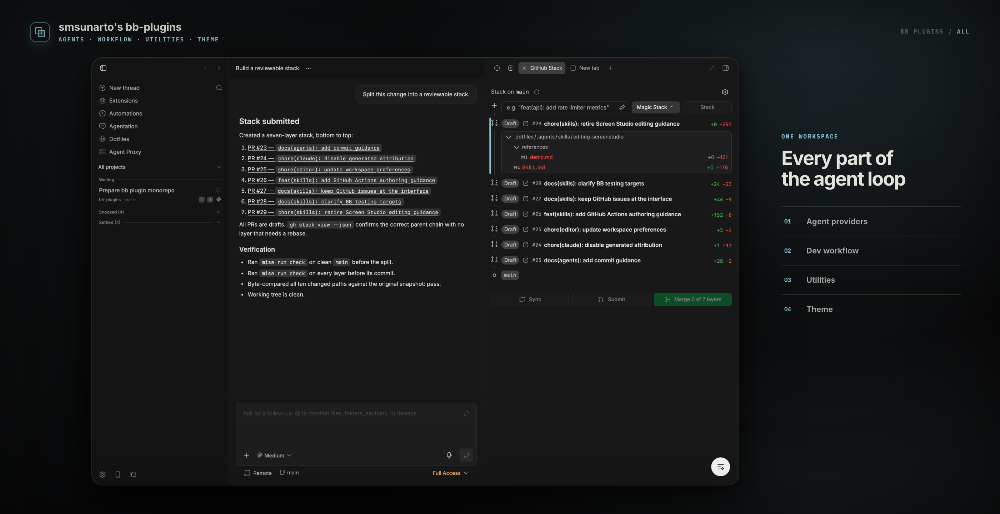

<div align="center">

# smsunarto's bb-plugins

**Plugins for [bb](https://github.com/get-bb/bb), the agent IDE — in one GitHub repository.**


</div>

<picture></picture>

### Agent Providers

<table>
<tr>
<td align="center" width="60"><picture><source media="(prefers-color-scheme: dark)" srcset="plugins/amp/assets/logo-dark.svg" /></picture></td>
<td align="center"><a href="plugins/amp/"><b>Amp</b></a></td>
<td>Runs <a href="https://ampcode.com">Amp</a> as a native bb provider, locally or in an Orb.</td>
</tr>
</table>

### Dev Productivity

<table>
<tr>
<td align="center" width="60"><picture><source media="(prefers-color-scheme: dark)" srcset="plugins/agentation/assets/logo-dark.svg" /></picture></td>
<td align="center"><a href="plugins/agentation/"><b>Agentation</b></a></td>
<td>Turns a click on any part of bb into a structured annotation an agent can act on.</td>
</tr>
<tr>
<td align="center" width="60"><picture><source media="(prefers-color-scheme: dark)" srcset="plugins/gh-stack/assets/logo-dark.svg" /></picture></td>
<td align="center"><a href="plugins/gh-stack/"><b>GitHub Stack</b></a></td>
<td>Drives a <code>gh stack</code> from the thread panel — build, sync, submit, merge — and can hand the split to your agent.</td>
</tr>
<tr>
<td align="center" width="60"><picture><source media="(prefers-color-scheme: dark)" srcset="plugins/traces/assets/logo-dark.svg" /></picture></td>
<td align="center"><a href="plugins/traces/"><b>Traces</b></a></td>
<td>Explore Claude Code and Codex sessions, instructions, and tool activity with keyboard navigation and extensible event renderers.</td>
</tr>
</table>

### Utilities

<table>
<tr>
<td align="center" width="60"><picture><source media="(prefers-color-scheme: dark)" srcset="plugins/gtd-sidebar/assets/logo-dark.svg" /></picture></td>
<td align="center"><a href="plugins/gtd-sidebar/"><b>GTD Sidebar</b></a></td>
<td>An action-oriented thread list with Next Action and Waiting sections. Forked from <a href="https://github.com/get-bb/bb/tree/main/examples/plugins/t3sidebar">bb's own example</a>.</td>
</tr>
</table>

### Themes

<table>
<tr>
<td align="center" width="60"><picture><source media="(prefers-color-scheme: dark)" srcset="plugins/monokai/assets/logo-dark.svg" /></picture></td>
<td align="center"><a href="plugins/monokai/"><b>bb Monokai</b></a></td>
<td>A dark Monokai-family palette for the whole app: one meaning per hue, a single text ladder, all 16 ANSI colors, and a matching diff viewer.</td>
</tr>
</table>

## Install

Add this repository as a marketplace once, then install by name:

```sh
bb marketplace add git:github.com/smsunarto/bb-plugins
bb plugin install gtd-sidebar
```

Adding a marketplace installs nothing — it caches the catalog, so these plugins
become findable by name in `bb plugin search` and in bb's plugin browser. `<id>`
is `agentation`, `amp`, `gh-stack`, `gtd-sidebar`, or `monokai`; if another
marketplace you have added publishes the same name, spell it
`gtd-sidebar@smsunarto`.

Every plugin ships as a git tag, and the catalog entry carries its release line.
bb resolves the newest `<id>/vX.Y.Z` tag, clones it, installs the plugin's
runtime dependencies, and builds both bundles against your bb — a plugin is
never shipped prebuilt, so it always matches the host it runs on. `bb plugin
update <id>` follows the same line.

## Build from source

This is the route for unreleased work. It puts each plugin in as a **local path source**, so bb reads the files in place: edit, rebuild, reload — no reinstall.

```sh
git clone https://github.com/smsunarto/bb-plugins
cd bb-plugins
bun install                              # one hoisted node_modules at the repo root
bun run build                            # bb plugin build for every plugin
bb plugin install ./plugins/<id>         # from the repo root
```

## Develop a plugin

Use BB's own build-and-reload loop for the plugin you are changing:

```sh
bb plugin install ./plugins/monokai
bb plugin dev ./plugins/monokai
```

The watcher targets the running BB selected by the CLI. It rebuilds and reloads the plugin on save.
Use `bb plugin source monokai`, `bb plugin list`, and `bb plugin logs monokai` to inspect it.
Run focused tests with BB's SDK testing harnesses, then verify the changed user flow in the app.

## Preview components with Storybook

Run `bun run storybook` from the repository root and open
[Storybook](http://localhost:6010). It discovers stories under
`plugins/*/storybook/` and `packages/*/storybook/` in two sections:
**Screens** for complete plugin views and **Components** for focused states,
shared controls, and the theme catalog. Start with Screens to review components
in context. The preview reuses Monokai's generated theme and decorators.
Run `bun run build-storybook` to export the catalog to `storybook-static/`.

The [Storybook MCP addon](https://storybook.js.org/docs/ai/mcp/overview) serves
agent tools at `http://localhost:6010/mcp` while the root Storybook command is
running. Project-level configuration is checked in as `.mcp.json` for Claude
Code and `.codex/config.toml` for Codex. Restart your agent after adding the
configuration; Codex requires the project to be trusted. These files do not
change global MCP settings. Agents must run on the same machine as Storybook
to use this localhost endpoint.

Port 6010 is shared by checkouts on the same machine. Start Storybook from the
checkout you are editing before connecting an agent. The command fails if that
port is occupied; verify which checkout owns the running server before reusing
it. To run multiple checkouts simultaneously, give each server a different port
and update both MCP configuration URLs in that checkout to match.

Claude Code asks you to approve the project MCP server on first use. Codex
loads its project configuration in a new session.

### Catalog coverage

Every browser plugin has a catalog under its own `storybook/` directory. Canvas
previews use BB's native sidebar, page header, tabbed panel, message, composer,
and settings components. Storybook builds these from the working files in a
local BB checkout: `BB_STORYBOOK_SOURCE`, or the sibling `../bb` directory.
BB's dependencies must be installed there. Restart Storybook after changing
that checkout. This does not modify or start the BB app.

Use the context toolbar to switch between **BB editor** and **Isolated component**.
**Auto** uses native context in Canvas and isolated examples in Docs. Switching
back to isolated mode reloads the preview document to remove BB's global styles;
Controls args and globals are retained. A missing or incompatible checkout shows
an explicit notice, and isolated previews remain available.

Use the width toolbar for 360px, 640px, and 1100px component containers. BB's native
panel divider controls the surrounding panel width. Backend calls are replaced
with local fixtures or rejected, and panel width stays within the story's state.
Run `bun run test:storybook:native` against the running local Storybook to check
the native integration; it fails if native BB is unavailable. The regular
`test:storybook` command tests isolated components without requiring BB source.

The stories render production components; parent stories exercise their rendered internal
helpers. States include loading, empty, populated, error, disabled, and selected
where the component supports them.

| Plugin                | Component coverage                                                             |
| --------------------- | ------------------------------------------------------------------------------ |
| Agent Instructions    | Rule editor, scopes, loading and errors                                        |
| Agentation            | Annotation list, empty and error states                                        |
| Amp                   | Oracle results, running trace, missing and invalid reports                     |
| Canvas                | Cards, sections, callouts, tables, controls, task lists, charts                |
| Cloudflare            | Notices, badges, copy control, quick-share lifecycle                           |
| Code Review           | Review and branch status, findings, comments, file tree, refresh state         |
| Devin                 | Starting and active Cloud session banners                                      |
| Dotfiles              | Source and Markdown editors, host picker, offline and missing repository       |
| Game Studio           | Workflow canvas, node cards and inspector, generation controls, verdicts       |
| GitHub Stack          | Stack panel, pull request cards, changed-file tree, loading and errors         |
| GitButler             | Workspace lanes, branch actions, conflicts, history, file lists and trees      |
| GTD Sidebar           | Thread cards, status indicators, compact layout                                |
| Kitchen Sink          | Image comparison, annotations, invalid paths, branding                         |
| Monokai               | Theme foundations, chrome, content palettes, surface composition               |
| Prompt Editor         | Tool browser, file editor, empty and error states                              |
| Reminders             | Saved cards, loading, empty and error states                                   |
| Docs                  | Note browser, Markdown editor, HTML card, invalid link                         |
| Inline Visualizations | Tweak controls, saving, read-only, original and empty states                   |
| Tasks                 | List, board, detail and activity, labels/presets/folders, controls and dialogs |
| Traces                | JSON inspector, long output, paging, empty and error states                    |
| Vimium                | Keyboard activation and visible link hints                                     |
| Whiteboard            | Markdown, code, empty states, diff tree                                        |

Shared controls live in `packages/ui`: buttons, inputs, textareas, class merging,
and hover motion. Plugins keep thin re-exports for their existing import paths;
compact sizing, native focus, and repository border styles remain explicit variants.
The **Shared** catalog tests these once, including icon sizing and Whiteboard styling.
Their CSS ships with the components so BB builds do not depend on Tailwind scanning
hoisted package sources. Selectors carry a content fingerprint to isolate different
released versions. After editing control CSS, run `bun scripts/shared-ui-styles.ts`.
CI checks the fingerprint, re-exports, and each consumer's built CSS.

Release Please tracks plugin paths. A shared UI change must include a change under
every consuming plugin path and release those consumers together: agent-instructions,
agentation, code-review, dotfiles, gh-stack, gitbutler, gtd-sidebar, html, scott-docs,
scott-tasks, and whiteboard. Private plugins use the same rebuild
step when installed from source.

The manager, docs, story surfaces, portals, and code highlighting use Monokai.
Semantic utility aliases are generated from its palette with
`bun scripts/storybook-theme.ts`; the test suite rejects stale aliases and checks
the rendered theme after every story. `.storybook/bb-theme.css` mirrors the
BB 0.46.1 plugin theme's typography, radii, fonts, and shadows; refresh that snapshot
from `PLUGIN_THEME_CSS` when changing the BB toolchain.

Host-only plugins do not have browser stories. Usage Bar's native macOS menu
is also outside this browser catalog. The SDK's public test runtime supplies
host controls and RPC fixtures, so Storybook does not read real accounts or
checkouts. Host-owned icons, Markdown, navigation, and composer behavior are
fixture substitutes; use live BB to verify those integrations.

Run `bun run test:storybook` for Chromium render and interaction tests. If
Chromium is not installed, run `bunx playwright install chromium` first.
`bun test scripts/storybook-coverage.test.ts` checks that every browser plugin
keeps its explicit surface inventory, including the Tasks views and Studio canvas. Keep fixtures local to the story and use explicit
RPC responses for pending, failure, and recovery states.

The existing plugin-local Storybook command still previews Monokai alone.
Use the root command for the repository catalog and MCP endpoint. Storybook
previews do not replace live BB checks of host integration and shadow DOM.
The catalog uses the root SDK test runtime (0.6.75); plugins with different SDK
pins still need their own build and live integration checks.

## Test another BB build

Use BB's own launcher from the BB checkout, following its `docs/debugging-and-qa.md`:

```sh
cd ~/git/bb
scripts/bb-dev-app current
scripts/bb-dev-app status
eval "$(scripts/bb-dev-app env)"
pnpm bb:dev plugin install /absolute/path/to/bb-plugins/plugins/monokai
pnpm bb:dev plugin dev /absolute/path/to/bb-plugins/plugins/monokai
```

The launcher reports the build's URLs, data directory, and logs. Use `scripts/bb-dev-app stop` when finished.
This repository does not manage BB checkouts, ports, or server processes.

## Documentation screenshots

`bun run screenshots` renders static documentation heroes without a BB server.
`bun run screenshots:fixtures` requires `BB_APP_URL`, set to the launcher's reported **App** URL, which differs from its API server URL in development.
Prepare the affected plugin, GTD sidebar, and bb Monokai through BB before capturing live fixtures.
Capture checks their source, running state, and selected palette without changing them.
