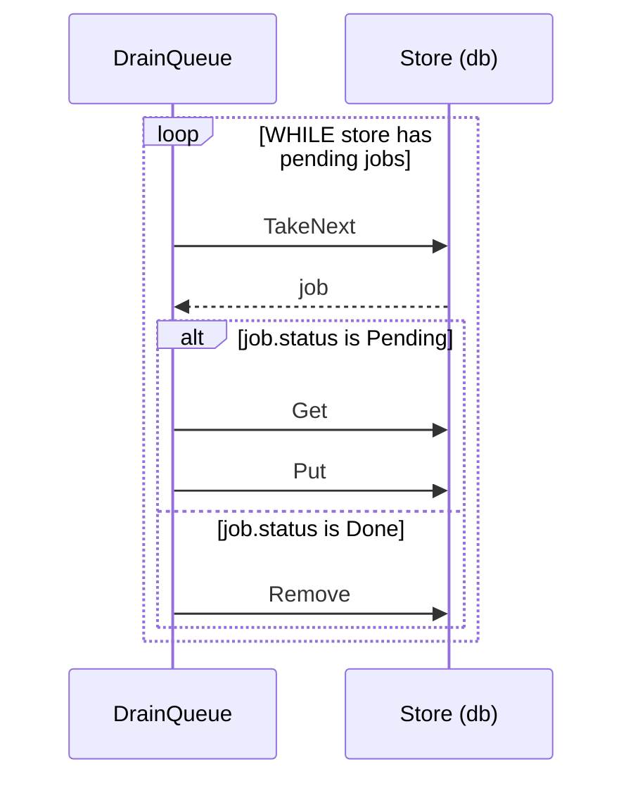

# Sequence diagram

A Mermaid sequence diagram replaces the call tree when the boundaries between processes are the point. Lanes make boundaries visible. Blocks carry the flow markers.

- A participant is a boundary or a routine that owns state. Helpers stay as arrows.
- `loop` is `WHILE` and `FOR EACH`. `alt` and `else` are `IF` and `SWITCH`. `par` is `spawn`. Label blocks with the same uppercase text the pseudocode uses.
- Solid arrow is a call. Dashed arrow is a return, shown only when the value drives the next call.
- The boundary goes in the participant label: `Store (db)`.
- For data flow rather than interaction, use a Mermaid flowchart instead.
