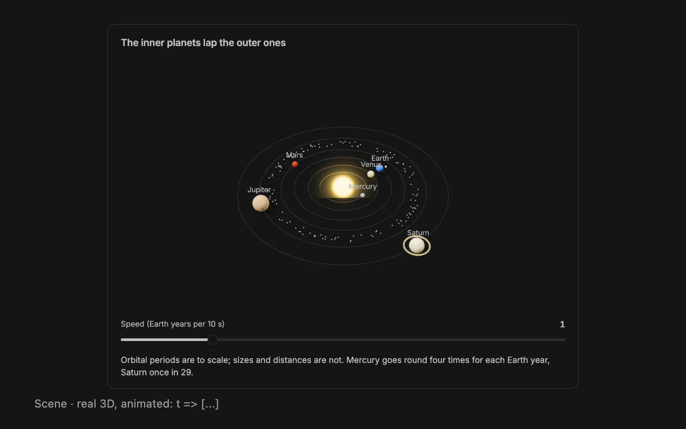

# Local GenUI fork

This package is maintained in `smsunarto/bb-plugins`. It imports
[ComicBit/bb-plugin-genui](https://github.com/ComicBit/bb-plugin-genui) version
0.3.1 at commit `c9700a34a9cc24961d17771590274e0703dc481c`.
The upstream Apache-2.0 license and bundled font license are preserved.

Local changes: workspace package metadata and dependency management, local
build/test commands, and agent text stored in `instructions/` for Prompt Editor.
The parser, renderer, gallery, and runtime behavior are retained from upstream.
Repository integration adds generated icons, a gallery story, and Apache license
checks. Lint reports inherited upstream diagnostics as warnings; the local
integration files retain the repository error levels. Formatter baselines retain
upstream layout and exact prompt text; newly authored code uses the repository format.

Install this copy from the repository root with
`bb plugin install ./plugins/genui`. The plugin keeps the `genui` identity.
To switch an existing Git-sourced installation, first save its settings with
`bb plugin config genui --json`: BB requires removing that installation before
installing the local path, and removal deletes its settings. Restore the saved
values with `bb plugin config genui set <key> <value>` after installation.

---

<div align="center">

# Generative UI for BB

**Your agents answer with charts, diagrams, maps, plans and forms you can use, drawn right in the chat.**



<sub>Every frame is a real component, rendered by BB from an example in [`gallery/`](gallery); the 3D slides are captured moving.</sub>

</div>

---

Agents in BB answer in markdown: a table for a comparison, a numbered list for a plan, a wall of pasted output after a test run. With this plugin they answer with the component the content calls for, and you can use it. Drag a slider and the numbers recompute. Click a box in a diagram to read about it. Pick an option or fill in a form and your answer goes into your message, beside anything you type; you send it when you're ready.

There is nothing to set up. Once the plugin is on, agents in your threads know the components and use them on their own.

## What an answer looks like

The agent writes a short block in its reply:

````
```ui
$seats = 10
$plan = "Pro"
price = $plan == "Pro" ? 29 : 12
Card("Estimate", [Form([
  Row([Choice($plan, ["Basic", "Pro"], label: "Plan"), Slider($seats, 1, 50, label: "Seats")]),
  Metric("Total", "$" + fmt(price * $seats))
])])
```
````

BB shows a card with a plan switch, a seat slider and a live total. Moving the slider recomputes the total in the page, without another model call. Your first change puts `Plan: Pro` and `Seats: 12` in your message box; every later change keeps those lines up to date, and they reach the agent when you send.

## What you get

- **88 components in 11 groups**, from cards, tables and charts to maps, kanban boards, Gantt roadmaps, quizzes, real 3D scenes, GPU shaders and sandboxed mini-apps. Browse all of them, with 180+ examples, on the **Gen-UI Gallery** page in BB's sidebar.
- **Interactive without extra model calls.** Sliders, toggles, editable tables and filters re-evaluate the UI in the page. Buttons, forms and plan approvals put your answers in your message, however many questions a reply asks; nothing is sent until you send it.
- **Files instead of retyped numbers.** The agent saves what a tool printed and the component reads it: test reports (vitest, jest, JUnit), logs, ESLint / `tsc` / SARIF findings, coverage (lcov, istanbul, coverage.py, Go), `npm outdated` and `npm audit`, CI runs, HAR files, hyperfine benchmarks. Code is shown from the file, at the lines asked for. Tables, charts and metrics say where their numbers came from: the file they loaded, or the `source:` the agent gave.
- **Your BB project, read live.** `Changes()`, `Commits()`, `PullRequest()`, `Threads()` and `Environments()` show the thread's diff, its branch, its pull request, its workers and your worktrees, straight from BB.
- **Evidence you can check.** Acceptance grids that say what was really verified and by whom, image comparisons with a pixel difference, transcripts aligned word by word with their word error rate, and the chain from a commit to what is actually installed or deployed.
- **At home in BB.** Components use BB's own colours and type, follow light and dark mode, render while the reply streams, and keep their state as you scroll back. They follow your system's reduced-motion setting, and the plugin's _Animations_ setting turns motion off altogether.

<table>
  <tr>
    <td><b>Layout</b></td>
    <td>Card · Row · Stack · Grid · Tabs · Details · Divider · Carousel</td>
  </tr>
  <tr>
    <td><b>Content</b></td>
    <td>Text · Callout · Metric · Badge · Icon · KeyValue · Image · File · Entity · Sources · List</td>
  </tr>
  <tr>
    <td><b>Data</b></td>
    <td>Table · Chart (bar, line, area, pie, scatter, radar, funnel, heatmap, histogram, box) · Sparkline · Progress · Gauge · SegmentedBar · Steps · Timeline · Calendar · CalendarHeatmap · Tree · Code · Snippet · Diff · Diagram</td>
  </tr>
  <tr>
    <td><b>Media</b></td>
    <td>ImageSearch · Gallery · Map · Hotspots</td>
  </tr>
  <tr>
    <td><b>Inputs</b></td>
    <td>Slider · Stepper · Toggle · Choice · Radio · Select · Checklist · ListEditor · Input · TextArea · DateInput · Rating · OptionCards · Swatches · EditableTable · Button · Form · FollowUps</td>
  </tr>
  <tr>
    <td><b>Widgets</b></td>
    <td>Timer · Quiz · Flashcards · Walkthrough</td>
  </tr>
  <tr>
    <td><b>Project</b></td>
    <td>Changes · Commits · PullRequest · Threads · Tests · Json</td>
  </tr>
  <tr>
    <td><b>Dev</b></td>
    <td>Logs · StackTrace · Findings · Coverage · Dependencies · Pipeline · Benchmark · Waterfall · Treemap</td>
  </tr>
  <tr>
    <td><b>Manage</b></td>
    <td>Board · Roadmap · Status · Plan · Decision · Estimate · Environments</td>
  </tr>
  <tr>
    <td><b>Evidence</b></td>
    <td>Acceptance · Compare · Transcript · Provenance</td>
  </tr>
  <tr>
    <td><b>3D</b></td>
    <td>Scene (solids, glass, surfaces, glTF models, HDR lighting; animated by <code>t =&gt; [...]</code>) · Shader (Shadertoy-style GLSL, multi-pass)</td>
  </tr>
</table>

For anything the components can't express, such as a small game or a simulation, the agent writes an `app` block: a self-contained HTML page that runs in a sandboxed frame with no network access. Apps use BB's theme and an SVG kit for diagrams, keep their `localStorage` with the reply, follow the _Animations_ setting, can put an answer in your message from a click (`genui.answer`), and open full screen or download as an HTML file. Agents get the full contract from `ui_examples(["app"])`, and `check_ui` checks an app before the reply.

## Install

```sh
bb plugin install https://github.com/ComicBit/bb-plugin-genui.git
```

Requires BB 0.45 or later. Agent sessions started after the install pick up the components. To update later, run `bb plugin update genui`; what changed in each version is in [CHANGELOG.md](CHANGELOG.md).

To try it, ask an agent something with a shape: _"Compare Postgres, SQLite and DuckDB for a local analytics tool"_, _"Plan a two-day trip to Lisbon"_, _"Run the tests and show me what failed"_. Or let the plugin open a subthread for you:

```sh
bb genui ask "Plan a two-day trip to Lisbon"
```

## What it costs, and what it touches

- **Tokens.** Sessions whose replies you read get about 15 KB of instructions (6,432 tokens, measured) that teach the components. Worker threads that another agent spawns get none. A UI costs no extra model call: it is part of the reply. BB sends the instructions again each time it restarts the agent process for a thread, and those copies stay in the context until it is compacted.
- **Web lookups**, on by default and controlled by the plugin's _Web lookups_ setting. They run on the BB server, never in the page: photo search on Wikimedia Commons (ImageSearch), the lead photo of a Wikipedia article a Map place names (en.wikipedia.org and Commons), place names to coordinates with Photon (Map), map tiles from OpenStreetMap, and https images a UI shows, fetched through a proxy that refuses private addresses. Each service sees your IP address and what is looked up (the search words, the article titles, the place names, the map area), never the rest of the thread. With the setting off, nothing is fetched and the components say so.
- **Files.** Components read only the thread's workspace, its thread storage and `/tmp`.
- **Size and GPU.** The 3D components bundle three.js, so the plugin's page code is about 1.6 MB (0.9 MB without them). A Scene or Shader holds a WebGL context only while it is near the screen, at most six at once; the others show their last frame as an image.
- **Elsewhere.** `bb genui render` prints a thread's last reply with every UI turned into plain markdown, for the terminal or for tools that read BB's SDK. In BB, _Copy as markdown_ beside a block's _Source_ toggle copies the same text, with the values you changed.

## How it fits into BB

On BB versions with `experimental_codeFenceRenderer` (merged in [get-bb/bb#5387](https://github.com/get-bb/bb/pull/5387)), BB hands `ui` and `app` fences directly to the plugin. UI renders while streaming and shows final diagnostics when the fence closes or the reply ends. Apps draw their markup while streaming but run only when their fence closes; an interrupted, unclosed app remains readable source. BB preserves the renderer instance throughout streaming and falls back to its code block if a language has conflicting plugins or a renderer crashes.

BB 0.45 and other versions without the slot still use the DOM overlay. That fallback considers a block complete after its text stops changing for 1.5 seconds: it cannot distinguish a closed fence from a pause or interruption. Changes to BB's page layout can turn those UIs back into code until the plugin catches up. State keys stay the same across the two rendering paths.

The full picture, from the instructions agents receive to how blocks stay steady while BB recycles rows as you scroll, is in [docs/architecture.md](docs/architecture.md).

## Develop

```sh
npm install
npm run typecheck && npm test
bb plugin build && bb plugin install .   # then, after changes: bb plugin reload genui
```

- `core/` is the spec language (lexer, parser, validator, an interpreter with no `eval`) and `core/catalog.ts` the list of components.
- `ui/components/` holds one renderer per component; `gallery/` the examples the gallery page and the `ui_examples` tool show.
- `node scripts/gallery-shot.mjs Map --mobile` screenshots one example; `node scripts/readme-media.mjs` rebuilds the carousel above from a running BB.

## License

[Apache-2.0](LICENSE). The diagram font, Excalifont, is under the SIL Open Font License ([assets/fonts/Excalifont-OFL.txt](assets/fonts/Excalifont-OFL.txt)). Every image in `gallery/` was drawn or rendered for this project.
