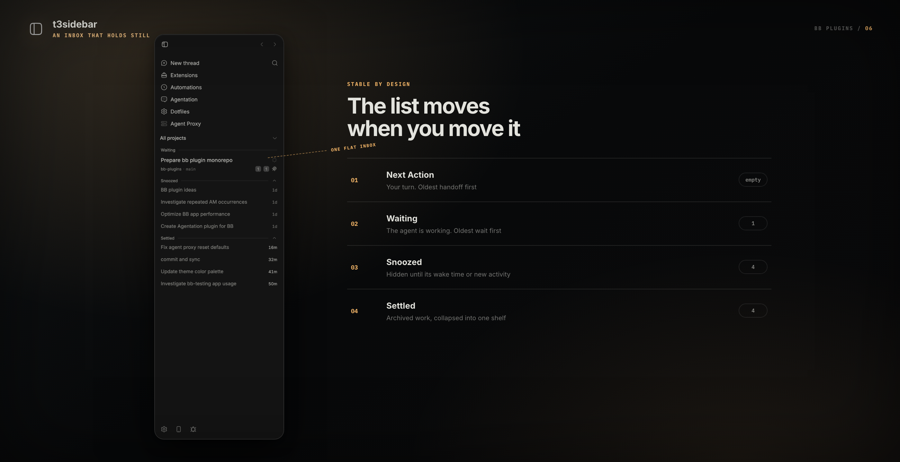
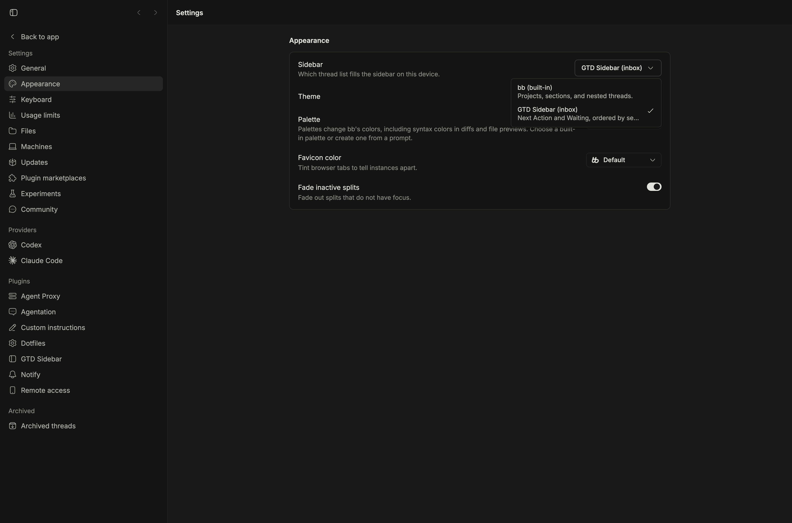

<div align="center">

<picture>
  <source media="(prefers-color-scheme: dark)" srcset="assets/logo-dark.svg" />
  
</picture>

# GTD Sidebar

**A thread list organized by who can act next.**


</div>

<div align="center">
<picture></picture>
</div>

GTD Sidebar is bb's own Thread list with its sections replaced by an inbox. Rows,
menus, drag and drop, rename, quick actions, and styling are bb's; the shelves are
GTD's.

Active threads split into **Next Action** when you can act and **Waiting** while
the agent works. Each shelf puts the newest arrival first.

You clear the list with two email verbs: **snooze** a thread until a wake time, or
**settle** it when you are done. Settle archives the thread in bb, and bb's Undo toast
brings it back. The SlopCop, Snoozed, and Settled shelves start folded.

## Install

**From the marketplace** — add this repository once, then install by name:

```sh
bb marketplace add git:github.com/smsunarto/bb-plugins
bb plugin install gtd-sidebar
```

bb resolves the newest `gtd-sidebar/vX.Y.Z` tag and builds the plugin from it against
your bb, so the bundle always matches the host it runs on. `bb plugin update
gtd-sidebar` follows the same release line. If another marketplace you have added
publishes a `gtd-sidebar`, spell it `gtd-sidebar@smsunarto`.

**From source** — clone the repo and install the plugin as a local path
source. This is also how you install a change that is not released yet:

```sh
git clone https://github.com/smsunarto/bb-plugins.git
cd bb-plugins
bun install
bun run --filter '@smsunarto/bb-plugin-gtd-sidebar' build
bb plugin install ./plugins/gtd-sidebar
```

The source path needs Bun and the `bb` CLI. It installs the plugin as a **local
path source**, so bb reads the files in place: edit, rebuild, reload, with no
reinstall.

## Requirements

- bb 0.48.1+
- Sidebar organization needs nothing else.
- Thread naming needs an existing Codex login on bb's primary host.

## Usage

Installing makes GTD Sidebar your sidebar. bb's **Automatic** choice picks an
installed thread list over its own. If you pinned a list under **Settings →
Appearance → Sidebar**, choose **GTD Sidebar (inbox)** there.

<picture></picture>

bb's own Thread list comes back the moment you pick it there or disable the
plugin.

### Shelves

The list draws bb's **Pinned** section first, then one sticky shelf header per
GTD shelf that holds a thread:

- **Pinned**: bb's own section and rule. A pinned thread shows here with
  every active thread under it, in bb's pinned order. A pinned thread or child
  you settle or snooze moves to that shelf instead.
- **Next Action**: the agent turn is done, an interaction needs input, or the
  thread is otherwise quiet.
- **Waiting**: foreground or background agent work is live, in the thread, any of
  its subthreads, or the hidden Review and Arena workers it launched. A family
  moves back to Next Action only when one of its threads asks you something.
- **SlopCop**: SlopCop's automated pull request reviews and issue triages, kept
  apart from your own work.
- **Snoozed**: hidden until the wake time you chose. A snoozed thread comes back
  early if it starts working or asks you something.
- **Settled**: every thread archived in the last 24 hours, whether you settled it
  here or archived it from bb's own sidebar.

A family always sits on its root's shelf. A pending interaction keeps a family in
**Next Action** even while background work is live, because you can act now.

### Sort and organize

Open the list header's menu for bb's own **Organize**, **Sort by**, and **Filter**
pages. GTD adds two choices to them:

- **Sort by → Arrival** is the default. A family's root keeps the place it took
  when it arrived on its shelf, so a turn starting, a read, a rename, or child
  activity never reshuffles it. Only a shelf change moves it, to the top of the new
  shelf. Snoozed sorts by when you snoozed and Settled by when it settled. bb's
  **Updated at**, **Created at**, and **Alphabetical** sorts still work.
- **Organize** groups each shelf **By project**, **By machine**, or **Flat**.

Groups draw only once a shelf view holds two or more projects or machines, or
while a machine filter is on. A group header sticks under its shelf header and
folds its group. Settled's groups start folded.

### Project groups

Project groups follow bb's project order in every shelf, with your personal project
last. Drag a project header onto another to reorder the project in bb itself, or
open its menu for **Move up** and **Move down**. Every shelf agrees, and bb's own
project lists follow. The personal project's group never drags.

A project header's menu and its **+** create a thread in that project. With a
project scope set, the list header's **+** does the same.

### Filters

The **Filter** page holds GTD's two filters:

- **Project** scopes the list to one project for this session. **All projects**
  clears it.
- **Machines** appears once threads run on two or more machines. Check the
  machines to show; the last visible machine stays checked. Choices persist across
  reloads and sync to other open windows and devices. New machines appear by
  default, and threads without a known machine stay visible.

### Rows

Every row is bb's thread row: unread titles, the status glyph, provider icons, the
split mini map, shortcut pills, hover quick actions, inline rename, multi-select,
and bb's optional metadata line. GTD adds:

- A globe before the title when the thread runs on another machine, in that
  machine's color. A Boat sandbox shows a bot instead.
- A shimmer on the title while GTD names the thread.
- On a snoozed row, the time left until it wakes, with the wake time on hover.
- The pull request number, colored by what it needs, while bb's metadata line is
  off. With the line on, bb's own pull request badge shows there instead.
- The GitButler branch on bb's metadata line, with **Show GitButler branches** on.

### Thread actions

GTD's verbs are bb thread actions, so they appear in every thread menu bb draws:
the row menu, right-click, the compact long-press menu, and the thread header. You
can also pick them as row quick actions under **Customize actions**:

- **Settle** archives the thread in bb. bb's Undo toast brings it back. Settling the
  open thread moves you to the next row on its shelf. A thread with subthreads waits
  for bb's confirmation first.
- **Un-settle** unarchives a thread on the Settled shelf.
- **Snooze until tomorrow** parks the whole family until 09:00 tomorrow. Live work
  or a pending interaction anywhere in the family hides it, so running work is never
  hidden. Workflows, background agents, background commands, plan mode, and goals
  all count as live work.
- **Wake now** brings a snoozed family back.

bb's own **Archive** stays in the menu beside Settle. The **GTD Sidebar: settle
thread** command in bb's palette settles the open thread.

### Child threads

A child sits under its parent with bb's disclosure chevron, including a fork bb
files as a child. A family folds until you open it, and the choice persists across
reloads. Drag a row onto another to nest it, or onto a group header to lift it back
to the top level. Rows on a shelf follow its sort; only Pinned reorders by drag. A
drag out to the main area opens a split.

### Thread names

With **Automatically name threads** enabled, a root thread gets a GTD-generated name on its first user prompt, replacing any
initial title supplied by BB. First-request inference can only generate a new
title, never keep BB's title. Later prompts keep the existing title unless you clearly start completely different work. Follow-ups,
corrections, tests, debugging, screenshots, commits, and shipping for the same
task keep its title. When the task change is uncertain, the title stays unchanged.
Queued prompts are checked when dispatched. New threads wait for their workspace
to be ready so the first title includes project naming rules. Agent replies and turn completion do
not trigger naming. New titles are plain text with no activity emoji. Prefixes
and other project formatting come only from your naming rules. Existing titles
are preserved exactly when the decision is to keep them.

The plugin sends a tool-free prompt to GPT-6-Luna with reasoning disabled and
reads a plain-text reply: the complete title, or `KEEP`. The first request, an
untitled thread, and explicit regeneration use a generation prompt that can only
rename. Later requests use a review prompt that sees the current title and may
keep it, and a keep decision does not write to the thread. Both prompts carry the
latest request, the original request, up to three recent requests, and your
project naming rules. A timeout, rate limit, outage, or unreadable reply retries once with
GPT-5.6-Luna, the same models and order as bb's built-in Codex AI service. Each
attempt has a five-second deadline. Logs record timing, never the prompt.

bb also titles a new thread through **Settings → AI services → Thread titles**,
and that title names a new worktree's branch. GTD naming then replaces the
thread's title with one that follows your project rules. Setting bb's thread
titles to Off saves that first request, but new branches are then named after
the start of the prompt.

Run the **configure-gtd-naming** skill to create or update
`.agents/GTD_NAMING.md` in your project. The skill inspects the project, chooses
compact naming rules, and writes the file. Scopes are configured there instead
of inferred automatically for every title. You can also edit the file directly:

```md
Use [GTD] for sidebar work and [Vimium] for keyboard navigation.
For work spanning both, use [GTD + Vimium]. Otherwise use a plain title.
Keep prefixes out of the task text.
```

The plugin reads the file from the active workspace on every naming request and
injects up to 500 characters of whole lines. The setup skill keeps the entire file
within that budget. An empty or non-UTF-8 file uses default instructions.

To replace a title by hand, run `bb gtd-sidebar rename [<threadId>]`. The command
uses the current thread when you omit the id. Explicit regeneration can replace a title even when
the task has not changed.

## Configuration

Choose plugin settings in **Settings → Plugins → GTD Sidebar**. Optional
enhancements default **off**, including while settings load. Layout preferences
(organize, sort, folds, row actions) live in the plugin's own storage and sync to
every open client. Read or change them with `bb gtd-sidebar prefs list|get|set|reset`.

### Feature catalog

Core means available while GTD Sidebar is your sidebar. Normal inbox behavior
does not call an AI model or poll external services. The explicit naming command
below is a separate, user-requested inference.

| Core sidebar feature    | What it does                                                                                                                       |
| ----------------------- | ---------------------------------------------------------------------------------------------------------------------------------- |
| Action shelves          | bb's Pinned, then Next Action, Waiting, SlopCop, Snoozed, and the last 24 hours of Settled. Running work and questions stay shown. |
| Groups                  | Group shelves by project or machine, fold groups, create a thread from a project, and reorder projects in bb.                      |
| Thread families         | Fold families, and nest or un-nest them with bb's drag and drop.                                                                   |
| Thread actions          | Settle, Un-settle, Snooze until tomorrow, and Wake now, in every bb thread menu and as row quick actions.                          |
| Navigation              | bb's row click, shortcuts, multi-select, split-open, and drag-to-split, plus the project scope and machine filters.                |
| Status and details      | bb's row status and metadata line, plus the machine globe, naming shimmer, wake countdown, and pull request number.                |
| Explicit naming command | `bb gtd-sidebar rename [<threadId>]` asks Codex for a title even with automatic naming off.                                        |

| Optional setting (key)                                  | Default | Effect when enabled                                                                                                                            |
| ------------------------------------------------------- | ------- | ---------------------------------------------------------------------------------------------------------------------------------------------- |
| Enable mobile haptics (`mobileHaptics`)                 | Off     | Play bb's iOS haptic when a row's menu opens.                                                                                                  |
| Show GitButler branches (`gitButlerBranches`)           | Off     | Read GitButler's applied branches on plain checkouts every 30s through the host CLI, and show them on bb's row metadata line.                  |
| Automatically name threads (`automaticallyNameThreads`) | Off     | Infer titles on your requests through the existing Codex login. Sends request context and naming rules. Off stops reads and in-flight renames. |

| Supporting preference            | Default           | Purpose                                                                                   |
| -------------------------------- | ----------------- | ----------------------------------------------------------------------------------------- |
| Local machine (`localMachineId`) | bb's primary host | Choose which machine's threads omit the globe. This doesn't change where any thread runs. |

### What changed in the bb Thread list rewrite

This version rebuilds the list on bb's Thread list at `desktop-v0.48.1`. Moving
to bb's components changes a few behaviors:

- Pinned follows bb's rule: a pinned thread shows with every active thread
  under it.
- A fork bb files as a child nests under its parent, as in bb's own list.
- Custom sections, **Move to section**, the **More** overflow, hiding threads, and
  the Active/Archived filter are gone. Settled replaces the archive view.
- A drag between Pinned and another shelf doesn't move the thread. Pin or unpin it
  from its menu.
- bb's **Archive** shows beside Settle.
- Folds are GTD's own. They no longer sync with bb's built-in Thread list.
- **Organize** replaces the `groupThreadsByProject` setting. A saved value for it
  is ignored.
- Rows show no age, and project, branch, and agent hover details are gone. bb's
  optional metadata line shows row details instead.

### Opt-in and migration behavior

- Existing **explicit saved values** keep their meaning, including saved `true`
  for automatic naming. No migration writes `true` on an existing or new
  installation.
- Settings take effect without a plugin reload. The selected sidebar itself stays
  bb's explicit Appearance preference.

## Troubleshooting

**My sidebar looks the same after installing.** An earlier choice in Settings →
Appearance → Sidebar outranks Automatic. Choose GTD Sidebar (inbox) or Automatic
there. Another installed thread list can also win Automatic; pick one explicitly.

**A snoozed thread came back early.** That is the design: a snoozed thread wakes when
it starts working or asks you a question.

**Uninstalling left data behind.** Snoozes live in the plugin's own database,
which bb removes with the plugin. Earlier versions also cached them in the
browser's `localStorage` under `gtd-sidebar:v1:*`. This version removes those
entries the first time it loads, so nothing stays behind.

## Credits

Forked from bb's own example, and released as `t3sidebar` until 0.3.0. bb keys a
plugin by its id, so the renamed plugin installs as a separate one: install
`gtd-sidebar`, then uninstall `t3sidebar`. Snoozes do not carry over — they live in
the old plugin's database and go with it.

|          |                                                                                                                                                                                |
| -------- | ------------------------------------------------------------------------------------------------------------------------------------------------------------------------------ |
| Upstream | [`get-bb/bb` → `examples/plugins/t3sidebar`](https://github.com/get-bb/bb/tree/f13c2d35f96540012b305f3b555839b30e1b6163/examples/plugins/t3sidebar)                            |
| Commit   | `f13c2d35f96540012b305f3b555839b30e1b6163` (2026-08-07)                                                                                                                        |
| Status   | Upstream removed the example in `9d0b8a9d5` (2026-08-20, #2143). Its last four commits only renamed the SDK package and raised the engines floor, both already reflected here. |

Thread naming adapts the lifecycle design from
[`suiramdev/bb-plugin-thread-namer`](https://github.com/suiramdev/bb-plugin-thread-namer)
at commit `023d1229db020330a940e4bff060e23bd4b278d8`.

The thread list is a fork of bb's built-in Thread list (`plugins/thread-list`) and
the component registry items it imports, at `desktop-v0.48.1`. GTD's shelves, row
extras, and filters sit on top of it. [THIRD_PARTY_NOTICES.md](THIRD_PARTY_NOTICES.md)
lists the fork base and the files GTD changed.

Provider icons are bb's own artwork, drawn through `experimental_ProviderIcon`
in one muted tint rather than in brand color — by design.

## Develop from source

Install from source as shown under [Install](#install), then check a change
with:

```sh
bun run --filter '@smsunarto/bb-plugin-gtd-sidebar' typecheck
bun run --filter '@smsunarto/bb-plugin-gtd-sidebar' test
```

The test script needs Node 22.6+.
